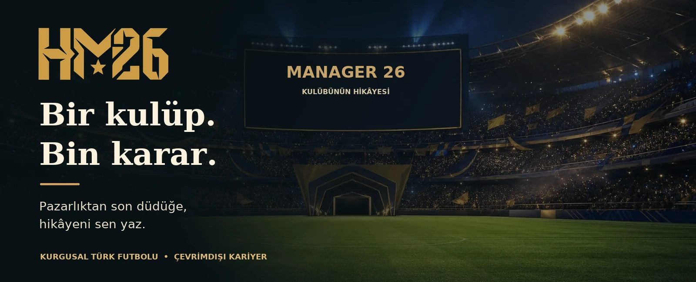
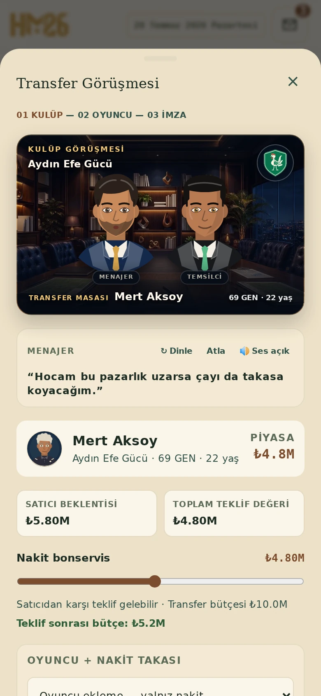
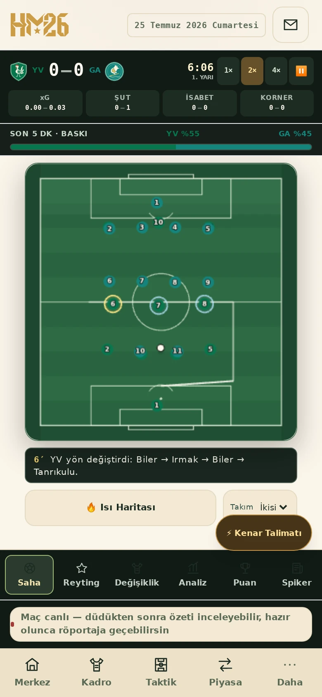

  

<h1 align="center">HM26 · Manager26</h1>

  <strong>Bir kulüp. Bin karar. Kendi futbol hikâyen.</strong> 
  Türkçe futbol menajerlik oyunu.

<strong><a href="https://hbkmanage26.pages.dev/">Oyunu oyna →</a></strong>

## HM26 nedir?

HM26, kurgusal bir Türk futbol dünyasında bir kulübün başına geçtiğin, tek oyunculu bir menajerlik oyunudur. Kendi menajerini oluşturur, kulübünü seçer ve kariyerini sezonlar boyunca şekillendirirsin.

## Oyunun amacı

Amacın, kulübünü hem sahada hem de saha dışında geliştirerek hedeflerine ulaşmak ve kendi başarı hikâyeni yazmak. Kadronu kur, taktiğini belirle, transferleri yönet ve maçlarda takımının başında ol. İstersen karşılaşmaları canlı yönetebilir, istersen hızlı simüle edebilirsin.

Desteklenen tarayıcılarda, gerekli dosyalar ilk açılışta kaydedildikten sonra çevrimdışı da oynayabilirsin.

## Oyundan görüntüler

<table>
  <tr>
    <td align="center" width="50%"></td>
    <td align="center" width="50%"></td>
  </tr>
  <tr>
    <td align="center"><strong>Transfer masası</strong></td>
    <td align="center"><strong>Canlı maç</strong></td>
  </tr>
</table>

*Görseller, kurgusal bir örnek kariyerden alınmıştır. Çevrimiçi sürüm depodaki son değişiklikleri henüz içermiyor olabilir.*
