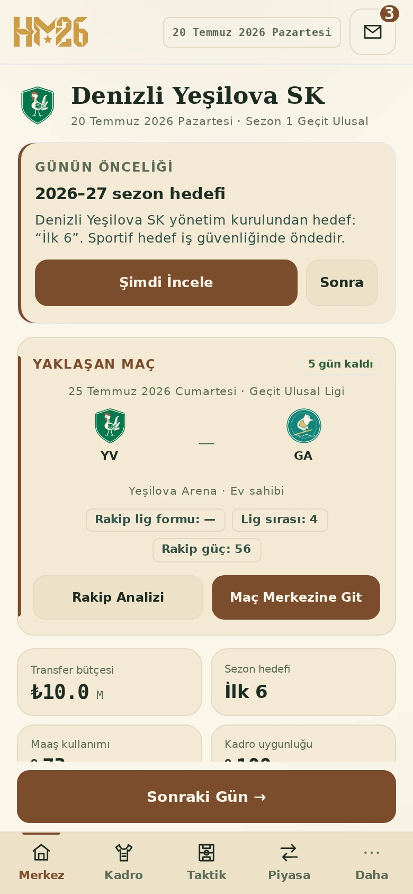
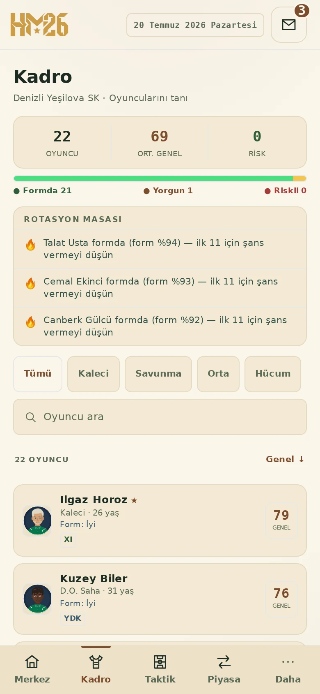
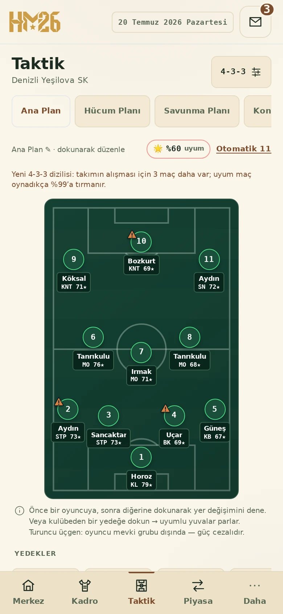
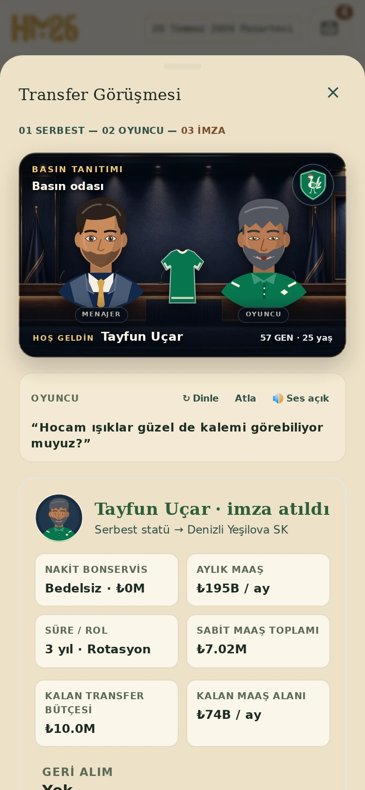
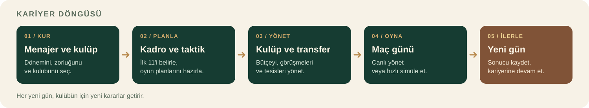
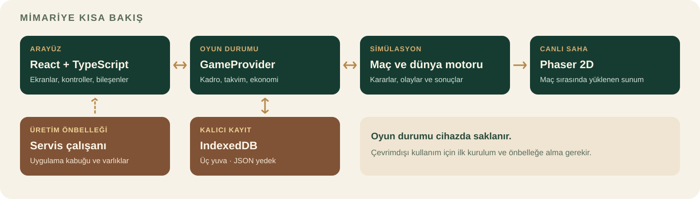

<p align="center">
  
</p>

<h1 align="center">HM26 · Manager26</h1>

<p align="center">
  <strong>Bir kulübün kaderi, verdiğin kararlarda.</strong><br>
  Türkçe, çevrimdışı öncelikli futbol menajerlik oyunu.
</p>

<p align="center">
  <a href="https://hbkmanage26.pages.dev/">Oyunu aç</a> ·
  <a href="#ekran-görüntüleri">Ekran görüntüleri</a> ·
  <a href="#oynanış">Oynanış</a> ·
  <a href="#kurulum-ve-geliştirme">Kurulum</a> ·
  <a href="#kayıtlar-ve-yedekleme">Kayıt ve yedekleme</a>
</p>

> Bu sayfa depodaki kaynak kodunu anlatır. [Çevrimiçi sürüm](https://hbkmanage26.pages.dev/) son kaynak değişikliklerini henüz içermiyor olabilir. Kulüpler, ligler, oyuncular ve kıta rakipleri **kurgusal oyun evreninin** parçasıdır; gerçek dünya lisansı iddiası yoktur.

---

## Bir bakışta

Bir menajer yarat, kendi hikâyesine ve hedeflerine sahip bir kulüp seç, kadronu kur ve maç gününe hazırlan. Transfer masasında pazarlık yaparken bütçeyi, sahada ise oyunun gidişatını yönet. Son düdük kariyerin sonu değil; basın, yönetim ve bir sonraki gün seni bekliyor.

| | HM26 |
|---|---|
| **Tür** | Tek oyunculu, futbol menajerlik ve kariyer simülasyonu |
| **Oyun dünyası** | Üç kurgusal yerel ligde 36 kulüp; başlangıçta kulüp başına 22 oyuncu |
| **Sahada** | Canlı 2D maç yönetimi veya hızlı simülasyon |
| **Saha dışında** | Transfer, taktik, akademi, tesis, finans, basın ve sezon yönetimi |
| **Kayıt** | Cihazda üç kariyer yuvası; JSON ile manuel yedekleme |
| **Platform** | Mobil öncelikli web uygulaması; desteklenen cihazlarda ana ekrana kurulabilir PWA |
| **Dil ve teknoloji** | Türkçe · React 18 · TypeScript · Vite · Phaser · Tailwind CSS · IndexedDB |

## Ekran görüntüleri

Kapak, oyundaki stadyum ve logo varlıklarından hazırlanmış bir tanıtım görselidir. Aşağıdakiler ise oyunun **gerçek arayüzünden**, örnek bir Denizli Yeşilova kariyeri oynanarak alınmıştır. İsimler ve kulüpler kurgusaldır; değerler, sonuçlar ve görünüm kariyere göre değişir. Ayrıntıları görmek için görsellere dokunabilir veya tıklayabilirsin.

<table>
  <tr>
    <td align="center" width="50%"><a href="docs/images/merkez.webp"></a></td>
    <td align="center" width="50%"><a href="docs/images/kadro.webp"></a></td>
  </tr>
  <tr>
    <td><strong>01 · Merkez</strong><br>Günün öncelikleri, yaklaşan maç ve kulüp özeti.</td>
    <td><strong>02 · Kadro</strong><br>Form, kondisyon ve rotasyon kararları.</td>
  </tr>
  <tr>
    <td align="center"><a href="docs/images/taktik.webp"></a></td>
    <td align="center"><a href="docs/images/canli-mac.webp"></a></td>
  </tr>
  <tr>
    <td><strong>03 · Taktik</strong><br>Diziliş, saha yerleşimi ve oyun planları.</td>
    <td><strong>04 · Canlı maç</strong><br>Sahayı izle, verileri incele, kenardan müdahale et.</td>
  </tr>
  <tr>
    <td align="center"><a href="docs/images/transfer-masasi.webp"></a></td>
    <td align="center"><a href="docs/images/tanitim.webp"></a></td>
  </tr>
  <tr>
    <td><strong>05 · Transfer masası</strong><br>Hareketli karakterler, seçilebilir cevaplar ve pazarlık.</td>
    <td><strong>06 · İmza</strong><br>Sözleşmenin ardından kulüp renkleriyle tanıtım.</td>
  </tr>
</table>

## Kariyer yolculuğu



1. **Kariyerini oluştur.** Menajerinin adını, görünümünü ve geçmişini belirle; dünya dönemini, zorluğu ve kulübünü seç. Bazı dünya ayarları kariyer başladıktan sonra kilitlenir.
2. **Takımını hazırla.** Oyuncuların formunu ve kondisyonunu incele; dizilişini, ilk 11'ini, yedeklerini ve oyun planlarını oluştur.
3. **Kulübü yönet.** Pazarda fırsat ara, sözleşmeleri ve bütçeyi gözet, tesislere yatırım yap ve akademi adaylarını değerlendir.
4. **Maç gününü yaşa.** Rakip analizine bak; karşılaşmayı canlı yönet ya da hızlı simülasyonla sonuçlandır.
5. **Sonraki güne geç.** Canlı maçın ardından ekranı incele, röportaj ve rapora kendi isteğinle geç, sonucu kaydet ve kariyerine devam et.

## Oynanış

### 🏟️ Kurgusal futbol dünyası

- **Miras Zirve**, **Geçit Ulusal** ve **Kök Bölge** ligleri arasında yükselme ve düşme mücadelesi ver.
- Yerel liglerin yanında Miras Kupası ve kurgusal kıta kupalarında fikstürü, grupları ve eleme turlarını takip et.
- Her kulübün kendi renkleri, arması, stadyumu, bütçesi, tesisleri, yönetim hedefi ve hikâyesi bulunur. Takvim 2026–27 sezonunda başlar ve sonraki sezonlara ilerler.
- Dünya ve oyuncular kariyerin başlangıç değerlerinden üretilir; aynı koşullardaki üretim tekrarlanabilirdir. Kulübün geçmişe dönük başlangıç arşivi de bu kurgusal dünyanın arka planıdır.

### 👥 Kadro, gelişim ve taktik

- Kadroyu mevkiye, isme, genel puana, forma ve yaşa göre incele. Rotasyon masası kondisyon, sakatlık ve form sinyallerini öne çıkarır.
- Oyuncu profillerinde formu, kondisyonu, maç ritmini, sözleşmeyi ve birikmiş kariyer verilerini takip et; uygun oyuncuları ilk 11'e taşı.
- **Altı diziliş** ve **beş plan yuvası** arasından seçim yap. Sahadaki oyunculara dokunarak yerlerini değiştir veya yedekleri yerleştir. Mevki dışı tercihlerde uyarı ve güç cezası gösterilir.
- Antrenman odağını ve yoğunluğunu belirle; sağlık, maç süresi ve oyuncu memnuniyetini gözet. Genç oyuncular için rehberlik ve akademi seçeneklerini değerlendir.

### 🤝 Transfer masası

- Oyuncu veya kulüp adına, mevkiye, değere, serbest statüye ve bütçeye göre pazarı filtrele; ilgilendiklerini kısa listeye ekle.
- Kulüplü oyuncularda nakit teklifin yanında oyuncu takası ve sonraki satış payı konuşulabilir. Kiralama, gelen teklifler, satışlar ve sözleşme yenilemeleri de piyasa ekranındadır.
- Görüşmelerde menajer, temsilci ve oyuncu **hareketli karakterler ve Türkçe sesli repliklerle** yer alır. Menajerin cevabını sen seçersin; seçeneklerin yanında olası küçük fayda ve riskler belirtilir. Diyalog tonu pazarlıkta sınırlı bir etki yapabilir, ancak tek başına anlaşmayı garanti etmez. Ses kapalıysa replikler metin olarak da takip edilebilir.
- Kulüp şartları ve oyuncu sözleşmesi ayrı aşamalardır. Ücreti, 2–5 yıllık süreyi ve Rotasyon/İlk 11/Yıldız rolünü gözden geçir; Yıldız rolü süre sözü içerir. Transfer ancak son **imza** ile tamamlanır.
- Bütçe, maaş alanı, 30 kişilik kadro sınırı ve lige göre yabancı kotası kontrol edilir. Serbest oyuncularla pencere kapalıyken de görüşülebilir.

**İmzadan sonraki tanıtım**, bonservis bedeline değil oyuncunun genel puanına göre seçilir:

| Oyuncunun GEN değeri | Tanıtım |
|---|---|
| **79 ve altı** | Görkemli basın odası |
| **80–84** | Stadyum |
| **85 ve üzeri** | Daha büyük ışık, tribün ve anonslarla özel yıldız stadyumu |

85 GEN ve üzerindeki **bedelsiz** bir oyuncu da yıldız stadyumunda tanıtılır.

### ⚽ Maç günü ve canlı yönetim

Maç merkezindeki hazırlık listesini ve rakip raporunu incele; maç günü geldiğinde canlı karşılaşmayı başlat veya hızlı simülasyonu seç.

Canlı maç konsolunda:

- **Saha:** Phaser ile çizilen 2D sahayı, topu ve oyuncu hareketlerini izle; istersen ısı haritasını aç.
- **Skor ve tempo:** Süreyi, skoru, takım xG'sini, şutları, isabetleri ve kornerleri izle; maçı duraklat veya 1×, 2×, 4× hızları arasında geç.
- **Müdahale:** Oyuncu değiştir, plan ve zihniyet değiştir, kenar talimatı ver; devre arasında konuşma seç.
- **Diğer sekmeler:** Oyuncu reytinglerini, canlı analiz ve şut haritasını, geçici puan durumu projeksiyonunu ve maç günlüğünü incele. Canlı tablo, maç kaydedilmeden kalıcı puan tablosu değildir.

**Son düdükte ekran otomatik olarak değişmez.** İstatistikleri ve sekmeleri inceleyip hazır olduğunda **Maç Sonu Röportajına Geç** düğmesini kullanırsın. Röportajdan sonraki raporda **Kaydet ve Günü Bitir** sonucu kaydedip günü ilerletir; istersen **Sonucu Kaydet — Ana Merkez** yolunu da seçebilirsin. Hızlı simülasyon ise sonucu doğrudan işler.

### 🏛️ Kulüp, basın ve veriler

- **Finans:** Transfer bütçesini, aylık maaş yükünü ve gerçekleşmiş transfer hareketlerini izle; transfer bütçesinden maaş alanına tek yönlü aktarım yap.
- **Tesisler ve akademi:** Antrenman, sağlık, akademi, analiz ve stadyum projelerini yönet. Akademi gününde adayları inceleyip imzalama veya pas geçme kararı ver.
- **Kulüp kültürü:** Yönetim güvenini, hedefleri, taraftar nabzını ve kulübe özgü kararları takip et.
- **Basın odası:** Oynanan maçlardan manşetler, lig nabzı, haftanın 11'i ve hakem/taraftar görünümleri oluşur. Röportaj tercihlerin menajer basın profilinde görünür.
- **İstatistikler:** Gol, asist, reyting ve kaleci sıralamalarının yanında takım ve lig analizlerini, ödülleri ve kupa vitrinini incele. Maç verisine dayalı analizler kayıtlı sonuçlardan türetilir; veri yeterli değilse boş durum gösterilebilir.

### ♿ Görünüm ve ses

Açık, koyu veya sistem temasını seç; metin boyutunu, yüksek kontrastı ve azaltılmış hareketi ayarla. Ana ses, tribün, efekt ve müzik tercihleri ayrı kontrol edilebilir. Kurulum ve bazı ses davranışları kullanılan tarayıcıya bağlıdır.

## Kurulum ve geliştirme

### Gereksinimler

- **Node.js 22.22.2 veya daha yeni bir 22.x sürümü** ve npm. Bu çalışma Node.js 22.22.3 ile çalıştırıldı. Kilitli `jsdom` sürümü ayrıca 24.15.0+ ve 26+ sürümlerini destekler.
- Bağımlılıkları ilk kez indirmek için internet bağlantısı.
- Tarayıcı testleri için Playwright Chromium ve işletim sisteminin gerekli kütüphaneleri.

### Kaynak koddan başlat

```bash
git clone https://github.com/HBK-1903/hm26.git
cd hm26
npm ci
npm run dev
```

Vite'ın terminalde gösterdiği adresi aç. Geliştirme sunucusunda servis çalışanı devreye girmez; çevrimdışı davranışı üretim derlemesiyle dene.

### Üretim derlemesini yerelde dene

```bash
npm run build
npm run preview
```

Derleme TypeScript kontrolünü yapar, uygulamayı `dist/` içine üretir ve servis çalışanının önbellek listesini oluşturur. Preview adresi genellikle `http://localhost:4173` olur; kesin adres terminalde yazılır. Bu komutlar yalnızca yerel çıktı üretir, siteyi yayınlamaz.

## Çevrimdışı oyun ve PWA

1. Uygulamayı **HTTPS** üzerinden veya aynı cihazdaki **localhost** adresinden çevrimiçiyken aç.
2. İlk yüklemenin ve üretim servis çalışanının kurulup uygulama varlıklarını önbelleğe almasının tamamlanmasını bekle. Tarayıcı destekliyorsa uygulamayı ana ekrana ekleyebilirsin; kurulum çevrimdışı oyun için zorunlu değildir.
3. Sonraki açılışlarda önbellekteki uygulama ve yerel kayıtlarla bağlantısız oynayabilirsin. Tarayıcı verisi veya önbellek silinirse, tarayıcı depolamayı kısıtlarsa ya da ilk kurulum tamamlanmadıysa bağlantı yeniden gerekebilir.

Üretim servis çalışanı uygulama kabuğunu ve yerel oyun varlıklarını önbelleğe alır. Varlık istekleri önbellek öncelikli, gezinme istekleri ağ önceliklidir; ağ yoksa önbelleğe dönülür. Transfer sahneleri ve ses dosyaları oyun varlıklarına dahildir. İşletim sistemi için hazırlanan `splash/` ve tanıtım amaçlı `screenshots/` görselleri ilk önbellek paketinin dışındadır.

Yeni bir uygulama sürümü bulunduğunda güncelleme kullanıcıya sunulur; bekleyen sürüm, uygulamadaki güncelleme onayından sonra etkinleşir. Ana ekrana ekleme seçeneği ve iOS/Android adımları cihaz ile tarayıcıya göre değişebilir.

## Kayıtlar ve yedekleme

- Kariyerler tarayıcının **IndexedDB** alanında, **üç ayrı yuvada** tutulur. Oyun gün sonu, maç sonu, transfer ve sezon geçişi gibi işlemlerde otomatik kaydetmeye çalışır; **Daha → Yedekleme → Şimdi Kaydet** de kullanılabilir.
- Kayıtlar bulut hesabıyla otomatik eşitlenmez. Başka bir tarayıcıya veya cihaza taşımak için JSON dosyası dışa aktarılmalıdır.
- Aktif kariyerde **Daha → Yedekleme → Dışa Aktar** seçeneğiyle dosyayı indir. Açılıştaki **Kariyerler** ekranında dolu yuvanın `⋯` menüsünden de dışa aktarabilirsin.
- Güvenli geri yükleme için açılış ekranında **boş bir yuvadaki “Buraya dosya içe aktar”** bağlantısını kullan. Kariyer içindeki **İçe Aktar** ise mevcut yuvaya yazar; değişikliği görmek için ana menüden kariyeri yeniden aç. Üzerine yazmadan önce o yuvayı yedekle.
- Dosya biçimi ve sürümü doğrulanır; desteklenmeyen daha yeni kayıt sürümleri reddedilir. Eski desteklenen kayıtlar açılırken uyarlama yapılır.

> **Önemli:** Tarayıcı/site verilerini temizlemek, özel oturumu kapatmak veya cihazı değiştirmek yerel kariyerleri kaybettirebilir. Özellikle güncelleme, tarayıcı temizliği ve cihaz değişiminden önce JSON yedeğini güvenli bir yere kaydet.

## Mimari ve proje yapısı



Arayüz ve oyun durumu React/TypeScript ile çalışır. Simülasyon mantığı maç ve dünya sonuçlarını üretir; Phaser bunları canlı 2D saha olarak sunar ve maç ekranında yüklenir. IndexedDB kariyer verisini saklar. Üretim servis çalışanı ise oyun veritabanı değil, uygulama kabuğu ve varlıkların çevrimdışı sunumu içindir.

```text
src/
├── screens/                 Kariyer, kadro, piyasa, maç ve diğer ekranlar
├── components/              Ortak arayüz, saha ve transfer sahneleri
├── data/                    Kulüpler, takvim, piyasa ve oyun dünyası verileri
├── engine/                  Maç simülasyonu, analiz ve oyun hesapları
├── store/                   Oyun durumu, IndexedDB ve kayıt uyarlamaları
├── audio/                   Ses motoru ve tercihler
├── hooks/ ve utils/         PWA ve ortak yardımcılar
public/
├── assets/                  Oyun içi görseller, marka ve transfer sesleri
├── manifest.json, sw.js     PWA bildirimi ve servis çalışanı kaynağı
└── icons/, splash/, screenshots/
tools/                       Derleme yardımcıları, QA ve tarayıcı testleri
docs/images/                 Bu README'nin kapağı, diyagramları ve oyun görüntüleri
```

Kaynak kod için başlıca giriş noktaları: [`src/screens/`](src/screens/), [`src/engine/`](src/engine/), [`src/store/persist.ts`](src/store/persist.ts) ve [`public/sw.js`](public/sw.js).

## Testler

Kilitli bağımlılıklar kurulduktan sonra kapsamlı regresyon koşusu:

```bash
npm run qa:all
```

Bu komut derlemeyi, çekirdek/entegrasyon kontrollerini ve Playwright tarayıcı senaryolarını sırayla çalıştırır; gerekiyorsa Chromium ve sistem bağımlılıklarını kurmaya çalışır ve `QA-AUTOMATION-LATEST.md` dosyasını günceller. Bazı ortamlarda tarayıcı kurulumu için ek izinler veya sistem paketleri gerekir.

Daha odaklı kontroller:

```bash
npm run qa:dayflow             # gün ilerletme ve maç sonrası akış
npm run qa:live:halftime       # devre arası kararları
npm run qa:transfer:scene      # transfer sunumu, ses ve eşik kuralları
npm run qa:transfer:scene:ui   # transfer ve kayıt entegrasyonu
npm run qa:match-core:evidence-insights
npm run build && npm run qa:pwa
```

Gerçek tarayıcı senaryolarını ayrı çalıştırmak için önce Chromium'u kur ve bir terminalde 4173 portunda üretim önizlemesini açık tut:

```bash
npx playwright install chromium
npm run build
npm run preview -- --port 4173 --strictPort
```

Başka bir terminalde:

```bash
npm run qa:transfer:scene:browser
npm run qa:e2e:live
```

Test betiklerinin tamamı ve diğer komutlar [`tools/`](tools/) ve [`package.json`](package.json) içinde bulunur.

## Yayınlama

Cloudflare Pages için derleme komutu `npm run build`, çıktı dizini `dist/` olarak ayarlanır. Elle yükleme, Wrangler, Git entegrasyonu, başlıklar ve PWA ayrıntıları için [`DEPLOY-CLOUDFLARE.md`](DEPLOY-CLOUDFLARE.md) dosyasına bak.

**Yerel build, PR önizlemesi ve production yayını farklı işlemlerdir.** Kaynak kodun veya önizlemenin güncel olması, canlı sitenin otomatik olarak aynı sürümde olduğu anlamına gelmez.

## Lisans

Bu depoda henüz açık kaynak lisansı tanımlanmamıştır. Deponun görünür olması tek başına kodu veya oyun varlıklarını yeniden kullanma ve dağıtma izni vermez.
